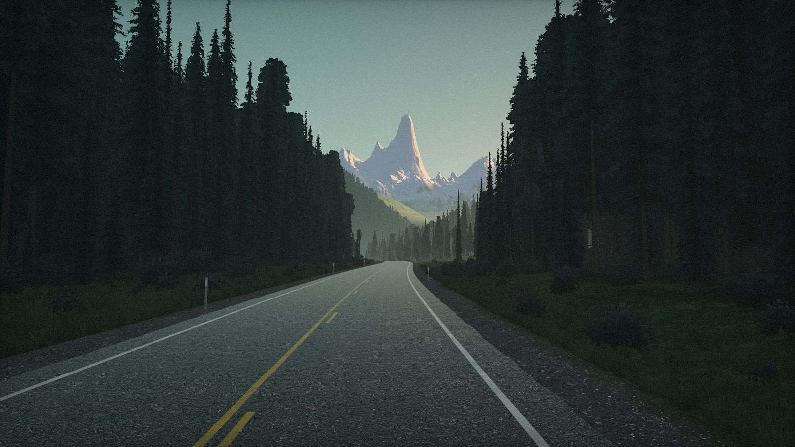

# Afterglow

> Those fleeting encounters,\
> those brief, beautiful moments—
>
> Could they have planted\
> seeds that quietly take root\
> and live on within our hearts?
>
> More and more, I believe\
> that those brought together by love\
> will find each other again.
>
> At some time,\
> in some place,\
> beneath some bright moon rising,\
> in some way I cannot yet imagine.
>
> Or perhaps,\
> within each other’s thoughts,\
> somewhere among the galaxies,\
> in that boundless sea of stars,\
> our signals have already crossed\
> and collided countless times—\
> and countless times,\
> we have found each other again,\
> with joy—

> 那些稍縱即逝的相遇，\
> 那些短暫而美好的時光——
>
> 會不會早已埋下\
> 悄悄生根的種子，\
> 從此活在我們心裡？
>
> 我愈來愈相信，\
> 因愛而相聚的人\
> 會再次找到彼此。
>
> 在某個時刻，\
> 在某個地方，\
> 在某輪初升的明月下，\
> 以某種我還想像不到的方式。
>
> 又或許，\
> 在彼此的思念裡，\
> 在星系之間的某處，\
> 在那片無垠的星海裡，\
> 我們的訊號早已交會\
> 也相撞過無數次——\
> 而無數次，\
> 我們再次找到了彼此，\
> 滿心歡喜——

程序化生成的 WebGL 场景：黄昏时山谷中的一条双车道公路，镜头沿路持续前进。



[English](README.md)

## 特性

- 道路、山谷、森林基于道路相对坐标生成，无限延伸且不重复
- 远山由高度场在加载时一次性光线步进，存为全景图后逐帧着色
- 约 80,000 棵树和灌木，加载时绘制图集，以实例化交叉面片渲染
- 解析式光照：日照缺口、树影条带、光束，不使用光源和阴影贴图
- 胶片式后期：高光柔和压缩、调色、暗角、颗粒、光晕
- 实时参数面板（**Tune**），支持单项重置、本地保存、导出 JSON
- 原生 ES 模块，无构建步骤，运行时不发起外部网络请求

## 环境要求

- 支持 WebGL2 的浏览器
- 任意静态 HTTP 服务器（ES 模块和 `fetch` 无法在 `file://` 下使用）

## 快速开始

```bash
python3 -m http.server 8000
```

打开 <http://localhost:8000>。

## URL 参数

| 参数 | 作用 |
| --- | --- |
| `?tune` | 加载时打开 Tune 面板 |
| `?s=1200` | 从道路 1200 m 处开始 |
| `?still` | 固定镜头，只渲染一帧 |
| `?atlas` | 不运行场景，显示树和草丛的绘制图集（用于编辑 `forest.js` / `verge.js`） |
| `?lang=zh` | 在面板英文标签旁显示另一种语言：`zh`（繁体中文）、`ja`、`ko`、`es`、`fr` |

参数可组合，如 `?s=1200&still`。

## Tune 面板

点击右上角 **Tune** 打开，修改即时生效。

| 分组 | 参数 |
| --- | --- |
| Travel 行进 | 速度、视角缩放、视线高低、镜头高度 |
| Land 山谷 | 山势起伏、噪声细节、雪线、道路弯曲、树林疏密、树木高度 |
| Air 天光 | 太阳方位、日照强度、余晖线、光束、雾气、谷底薄雾、云量 |
| Film 底片 | 曝光、饱和度、色相、冷暖、对比、暗角、颗粒、光晕、帧间残影、渲染比例 |
| Colour 染色 | 天顶、余晖、天边、树林、夕照、草地、路面、受光的雪、背光的雪 |

| 控件 | 行为 |
| --- | --- |
| reset | 恢复单个参数；仅在该参数改动后显示 |
| Reset all | 恢复全部参数并清除已保存的设置；需再按一次确认 |
| Keep | 将当前设置保存到 `localStorage`（仅限当前浏览器） |
| Copy | 将改动过的参数复制为 JSON |
| Hold | 停止镜头移动；云和颗粒照常 |
| Replay | 回到起点并重新播放淡入 |

如需将某组设置作为所有访客的默认值，把 **Copy** 得到的 JSON 粘贴进 `src/config.js` 的 `tuned: {}`，之后 **reset** 也会恢复到这组值。手动设置渲染比例后，自动降分辨率停用。

## 配置

所有可调数值集中在 [`src/config.js`](src/config.js)：速度、镜头、道路几何、森林、地形、调色板、雾、光照、调色和画质。长度单位为米，角度为度，颜色为 sRGB。

## 实现原理

### 道路空间

整个世界用两个坐标描述：沿道路的距离和到中线的横向偏移。中线是若干波长互不可公度的正弦之和，因此道路无限长且不重复。地形和植被都相对道路定义，保证道路位于谷底、树不会长在路面上。弯道半径不小于约 290 m，坡度不超过约 4%。

### 近处建模，远处绘制

约 4 km 以内的山谷、道路、树木是真实几何体；更远的山和天空由着色器绘制在天穹上。两者通过同一套雾模型衔接。

### 远山（`range.js`）

7–36 km 外的一片高度场，生成方式参照 Iñigo Quilez 的 *Elevated*：fBm 在坡度已陡处衰减高频八度，形成侵蚀状的山脊和山谷。由于镜头移动时远山几乎不变，光线步进只在加载时按视线方向执行一次，结果存为记录距离和表面法线的地平线全景图（大屏 8192×1024，其他 4096×512）。烘焙分 16 段执行，避免触发 GPU 看门狗超时；mipmap 在最后统一生成一次。每帧只采样全景图并着色：按朝向受光、峰间短距离步进求阴影、按海拔和坡度分布积雪、岩石层理、距离雾化。只有山势起伏和噪声细节会触发重新烘焙，松开滑杆后约 0.1 s 完成。

岩石和雪的细节来自 Poly Haven 贴图。*Rock Face 03* 按 1.3 km 宽投射，并叠加一层四分之一尺度；采用两个侧向投影，使裂缝保持水平和竖直；只取细节和法线，不取颜色。*Snow 02* 只取法线，自上而下投射。全景图中的距离以半浮点存储，精度达米级，贴图不会滑动。

### 地面

一张网格以 16 m 为步长跟随镜头，在 GPU 上变形贴合山谷。每一行总是落在之前某一行占过的位置，镜头前进时轮廓不会闪动。

### 树木

加载时在画布图集上绘制八种植物：六种针叶树（花旗松、云杉、亚高山冷杉、铁杉、顶梢枯死的老冷杉、扭叶松）、一棵幼树和一丛灌木。枝条从下往上绘制，每根先向已绘制的枝条投下阴影。除轮廓外，图集还记录亮度、在枝条上的外伸程度（只有外层枝梢接收天光和阳光）、木质或针叶。小枝和树皮细节来自 Poly Haven 的 *Fir Tree 01*、*Pine Tree 01* 贴图，颜色由调色板决定。每棵树由三片交叉面片组成，全部在一次实例化绘制中完成。实例数量（`config.js` 的 `forest`）为：森林 24,000 棵，其中约 45% 位于道路两侧的林带；谷壁另有 50,000 棵（窄屏 25,000 棵）；林缘灌木 3,200 丛；空地灌木 2,600 丛。每个实例按上述比例随机分配。近距离时用拉长的噪声把边缘侵蚀成针叶。灌木随林缘的开合移动。

### 光照

场景中没有光源，也没有阴影贴图。

- **日照缺口**：最后的阳光落到谷底的位置，是沿道路缓慢变化的函数（`sunGap`）。
- **树影**：太阳很低，树影视为沿太阳方位无限延伸的平行条带，遮挡只取决于一个坐标，用三条正弦叠加表示（`streaks`），固定在地面上。
- **光束**：视线穿过的受光雾量是这些正弦沿视线的闭式积分，因此朝向太阳时光束分离、横向时融合，且不闪烁。
- **叠加光照**：阴影中的表面只接收天光（`light.sky`），被阳光照到的表面再叠加一份暖光。
- **树冠**按圆体着色，只有朝光一侧和外层枝梢受光，并带有逐树和斑驳的变化。
- **远峰**只有高于余晖线（`light.peaks`）的部分受光：受光处为桃粉色，背光处为深蓝，朝日落方向的背光面略带粉色。
- **天空可见度**：两侧林墙收紧时，谷底可见的天空减少（`skyView`），亮度随之降低。
- **柏油路面**在掠射角反射天空，受光段对阳光前向散射（`beam.shine`）。谷底薄雾只在朝向太阳时发亮（`beam.glow`）。直立物体比平地接收更多低角度阳光（`beam.upright`）。

### 贴图

照片贴图（柏油、草、岩石、雪）只提供细节：除去每张贴图自身的平均色，颜色由调色板控制。柏油错开采样两份、每隔几米交替，掩盖 2 m 的平铺重复；粗糙度贴图使磨损处更多反射天空。草地贴图另以 16 倍和 128 倍尺度采样，使远处山坡呈现树冠与空隙的纹理。约 30,000 丛直立草丛（`verge.js`）只保留在镜头周围 160 m 内。贴图在加载后 1.5 s 内淡入；加载失败时保留程序化表面。

2K 贴图已足够：最近的路面距镜头 6 m，4K 屏上一个像素覆盖超过 2 mm 路面，而 2K 贴图一个纹素为 1 mm，更大的贴图不会被采样到。如需更换，修改 `src/config.js` 中的 `surface.size` 并下载对应贴图。

### 后期处理（`film.js`）

单个全屏 pass：0.75 以上柔和压缩而非截断，远超白色的部分才褪色；轻微降饱和；暗部偏冷、亮部偏暖；暗角；细颗粒，同时消除色带；从场景渲染目标的 mip 链取光晕，阈值 0.8，只有受光的雪、日落方向的天空和受光枝梢会晕开。可选帧间残影。

### 性能与降级

- 帧时间持续超出预算时降低渲染比例（最低 60%），只降不升。
- 标签页隐藏时暂停渲染。
- 开启 *prefers-reduced-motion* 时只渲染一帧静止画面。
- 不支持 WebGL2 时显示一行提示。
- 竖屏时自动加大视角。

## 项目结构

| 路径 | 用途 |
| --- | --- |
| `index.html`、`style.css` | 页面：画布、角落标签、Tune 面板 |
| `src/config.js` | 所有可调数值 |
| `src/path.js` | 道路中线（CPU 端，供镜头使用） |
| `src/glsl.js` | 共用 GLSL：道路、地形、雾、uniform |
| `src/maps.js` | 贴图加载（主线程外解码） |
| `src/range.js` | 远山地形与全景图烘焙 |
| `src/sky.js` | 天空、云、远山着色、两层较近的林坡 |
| `src/ground.js` | 山谷网格、路面、标线 |
| `src/forest.js` | 树和灌木的绘制与布置 |
| `src/verge.js` | 直立草丛 |
| `src/posts.js` | 示廓桩 |
| `src/film.js` | 后期处理 |
| `src/tune.js` | Tune 面板 |
| `src/main.js` | 帧循环、镜头、分辨率调节 |
| `vendor/three/` | 打过安全补丁的 Three.js 0.186.1 |
| `tools/vendor-three/` | `vendor/three/` 的补丁与可复现构建 |
| `textures/` | Poly Haven 贴图 |
| `fonts/` | Newsreader 字体 |

## 第三方组件

| 组件 | 作者 | 许可 |
| --- | --- | --- |
| [Three.js](https://threejs.org) 0.186.1 | three.js authors | MIT（[`vendor/three/LICENSE`](vendor/three/LICENSE)） |
| [Worn Asphalt](https://polyhaven.com/a/worn_asphalt) | Amal Kumar | CC0 |
| [Sparse Grass](https://polyhaven.com/a/sparse_grass) | Amal Kumar | CC0 |
| [Fir Tree 01](https://polyhaven.com/a/fir_tree_01)（仅小枝和树皮贴图） | Rob Tuytel、Rico Cilliers | CC0 |
| [Pine Tree 01](https://polyhaven.com/a/pine_tree_01)（仅小枝和树皮贴图） | Rob Tuytel、Rico Cilliers | CC0 |
| [Rock Face 03](https://polyhaven.com/a/rock_face_03) | Dario Barresi、Rico Cilliers | CC0 |
| [Snow 02](https://polyhaven.com/a/snow_02) | Rob Tuytel | CC0 |
| [Newsreader](https://github.com/productiontype/Newsreader) | Production Type | SIL OFL 1.1（[`fonts/OFL.txt`](fonts/OFL.txt)） |

随附的 Three.js 由官方 npm 源码构建，补丁涉及属性绑定、动画缓存、曲线采样和阴影材质缓存，均不影响本场景的渲染。详见 [`tools/vendor-three/`](tools/vendor-three/)；可直接替换为同版本的官方构建。

## 致谢

感谢：

- **mdb**：[*Up in the Cloud Sea*](https://www.shadertoy.com/view/Ndc3zl)（ShaderToy）。`sky.js` 中分层噪声轮廓山脊、随距离变化的视差，以及 `film.js` 中暗角曲线的来源。
- **Tianxiu (Tyson) Zhou**：*Up in the Cloud Sea* 的课程改编，研究过其 GLSL 源码。
- **HoytXU**：[*Cloudglen Express*](https://github.com/HoytXU/cloudglen_express)，将同一场景拆解为噪声、fBm、视差、遮罩、烟雾与合成的 WebGL2 解析。
- **Rice-dog**：[*code-codex*](https://github.com/Rice-dog/code-codex) 中的 Cloud Train Background，mdb 着色器的可调参数版改编。
- **incarnation-gem**：[*落日云间列车*](https://github.com/incarnation-gem/sunset-cloud-train)（Sunset Cloud Train），提取自 Rice-dog 插件、带设置面板的独立版。Tune 面板的设计参照。
- **Iñigo Quilez**：*Elevated*（2009）。远山地形生成方法的参照。

本仓库不包含上述作品的代码。

## 许可

[MIT](LICENSE)，适用于 `vendor/`、`textures/`、`fonts/` 以外的全部内容。第三方组件沿用各自的许可（见上）。
